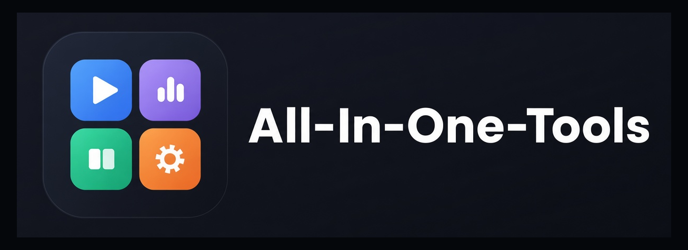
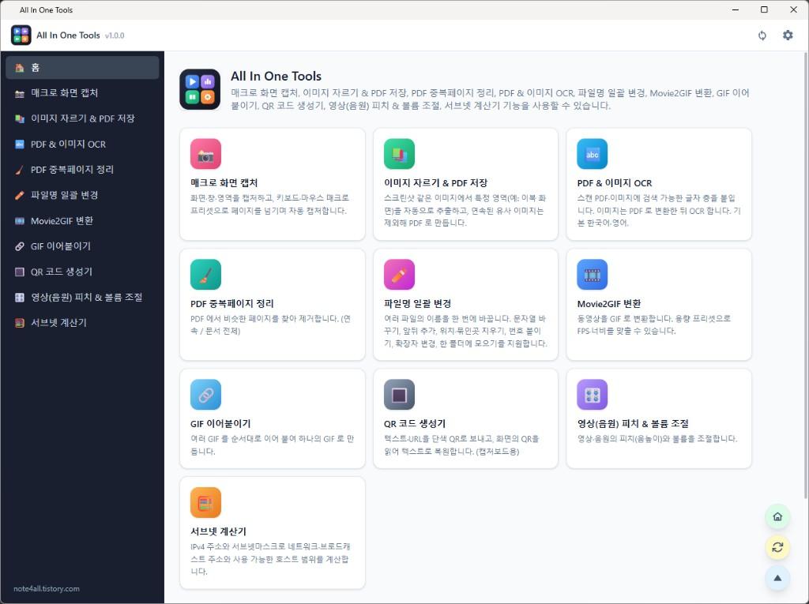

# All In One Tools

로컬 전용 Electron 도구 모음(매크로 화면 캡처(화면·창·영역 캡처, 키보드·마우스 매크로 프리셋), 이미지 자르기 & PDF 저장, PDF 중복페이지 정리, PDF & 이미지 OCR, 파일명 일괄 변경, Movie2GIF 변환, GIF 이어붙이기, QR 코드 생성기, 피치 & 볼륨 조절, 서브넷 계산기). 로그인·회원·웹 접속 없이 이 PC에서만 동작하며, **기능만 추가**하면 된다.

## 명령

| 명령 | 설명 |
| --- | --- |
| `npm install` | 최초 1회 |
| `npm run dev` | 실행 (화면 소스를 감시 빌드하고 저장 시 창을 자동 새로고침) |
| `npm run dev:restart` | 중지 후 재기동 |
| `npm run dev:stop` | 이 프로젝트의 Electron 프로세스를 모두 종료 |
| `npm run build:release` | Windows MSI + portable zip → `release/` |
| `npm run build:release:mac` | macOS dmg → `release/` (macOS 에서만 실행 가능) |
| `npm run update:all` | npm 의존성(`@latest`, 메이저 포함) + Electron 최신화 (`update_all.bat` 으로도 실행) |
| `npm run build:update_all` | 최신화 + `build:release` (Windows) |
| `npm run build:update_all:mac` | 최신화 + `build:release:mac` (macOS) |

`update:all` 옵션: `--skip-git`(git pull 생략) `--skip-npm` `--skip-majors`(Electron·electron-builder 만 최신화) `--build`. 로그는 `update_all.bat` 실행 시 `.cache/logs/update-all.log` 에 남는다.

산출물 이름: `AllTools_<YYMMDD_HHMMSS>_<arch>.msi`, `AllTools_portable_<stamp>_<arch>.zip`, `AllTools_<stamp>_<arch>.dmg`.

서버·네트워크 포트가 없다. 화면과 기능 처리는 Electron 내부 통신(IPC)으로만 연결되므로 다른 PC·브라우저에서는 접근할 수 없다. 기본적으로 창을 닫으면 종료되며, 실행 중에 다시 실행해 여러 개를 동시에 띄울 수 있다. 환경설정에서 「닫으면 트레이로 보내기」를 켜면 창을 닫아도 트레이에 남고, 다시 실행하면 숨겨 둔 창이 다시 열린다. Windows 작업표시줄 아이콘은 `com.alltools.app` AppUserModelID 와 exe 내장 아이콘을 쓰도록 맞춰 두었다(재부팅 후 기본 아이콘으로 풀리는 현상 완화).

## 구조

- `main.js`, `preload.cjs` — Electron 진입점 (API 호출과 파일/폴더 선택 등 네이티브 기능은 preload 로 노출, 메인에서 요청 출처 검증)
- `electron/devRenderer.js` — 개발 시 화면을 `.dev-dist/` 로 감시 빌드 (운영은 `dist/` 를 파일로 로드)
- `electron/api/coreApi.js` — 기본 API (앱 정보, 설정, 업데이트 확인)
- `electron/modules/*` — 기능별 API (변환, 이미지 자르기·PDF 저장·PDF 정리, PDF & 이미지 OCR, QR 코드 생성기, 매크로 화면 캡처, 파일명 일괄 변경)
- QR 코드 생성기: Tiny QRcode Generator 와 같이 보내기(텍스트·URL → 단색 QR, 긴 텍스트 QRT1 압축) / 받기(화면 영역 드래그 → QR 인식)를 지원한다.
- PDF & 이미지 OCR: Tiny PDF Editor 와 같은 PP-OCRv5 ONNX(`electron/ocr/`)로 검색 가능 글자 층을 붙인다. 이미지는 PDF 로 변환한 뒤 OCR 한다. 기본 한국어·영어, 다른 언어는 옵션(모델 다운로드). 모델은 `ocr/models/` (`npm run prepare:ocr`).
- 파일명 일괄 변경: 이름 변환은 화면(`src/features/rename/ops.js`)에서 미리보기로 만들고, 실제 변경은 `rename.apply`(`electron/modules/rename.js`)가 전부 검증한 뒤 임시 이름을 거쳐 적용한다. 마지막 적용은 "실행 취소"로 되돌릴 수 있다.
- `electron/capture/*` — 매크로 화면 캡처: 화면·창·영역 캡처(`screenCapture.js`), 영역 선택 오버레이(`regionPicker.*`), 매크로 실행기(`macroRunner.js`, 키보드·마우스는 nut.js), 프리셋 저장(`presets.js` → `macros.json`)
- `electron/settingsService.js` — 설정 저장
- `shared/*` — 메인/화면 공용 코드 (`constants.js` 에 앱 이름·버전)
- `src/` — React 화면. `src/lib/apiClient.js` 가 API 클라이언트 (`window.frame.api` → IPC `api:call` → `dispatchApi`)

## 기능 추가 방법

1. 화면: `src/features/<id>/` 를 만들고 `src/features/registry.js` 에 한 줄 등록 (2개 이상이면 사이드바 표시)
2. 서버 API: `electron/modules/<name>.js` 에서 `defineApi(이름, 핸들러)` 로 등록하고 `electron/modules/index.js` 에 추가
3. 화면에서 호출: `api('이름', 본문)`
4. 파일은 업로드하지 않고 `window.frame.pickOpenFiles` 로 로컬 경로를 받아 처리하며, 결과는 로컬 폴더에 저장한다.
5. 환경설정 항목 추가: `src/components/settings/GeneralSettingsPanel.jsx` 에 섹션 추가

## 데이터 위치

- 개발: `<프로젝트>/data` (설정 `settings.json`)
- portable: exe 옆 `data` (zip 안에 `.portable` 표시 파일 포함)
- 설치형: 사용자 데이터 폴더 아래 `data`
- 매크로 화면 캡처의 프리셋은 같은 `data` 폴더의 `macros.json` 에 저장된다. 캡처 이미지의 기본 저장 위치는 `사진/All In One Tools`.
- `APP_DATA_DIR` 환경변수로 재지정 가능

## 앱 이름·버전 바꾸기

`shared/constants.js` 와 `package.json`(name/version/build.appId), `installer/Product.wxs` 의 UpgradeCode 를 새 앱에 맞게 바꾼다.

## 아이콘

- 원본은 `assets-src/icon.svg`(벡터)이고, `build/icon-source.png`(1024)로 렌더해 둔 것에서 `npm run dev`/빌드 시 `scripts/prepare-icons.mjs`가 `build/icon.{png,ico}`, `public/icon.png`, `public/favicon.ico`를 만든다.
- 아이콘을 바꾸려면 `build/icon-source.png`를 교체한 뒤 `node scripts/prepare-icons.mjs`를 실행한다.

## 라이선스

이 프로젝트는 [GNU Affero General Public License v3.0](https://www.gnu.org/licenses/agpl-3.0.html)(**AGPL-3.0**)으로 배포된다. 전문은 저장소 루트의 `LICENSE`를 본다.

PDF & 이미지 OCR 경로에서 [MuPDF](https://mupdf.com/)(`mupdf`, AGPL-3.0-or-later)를 사용하므로, 바이너리를 배포할 때는 AGPL에 따른 **대응 소스 공개·고지** 의무를 함께 지킨다. PP-OCRv5 ONNX 모델은 Apache-2.0이다.
