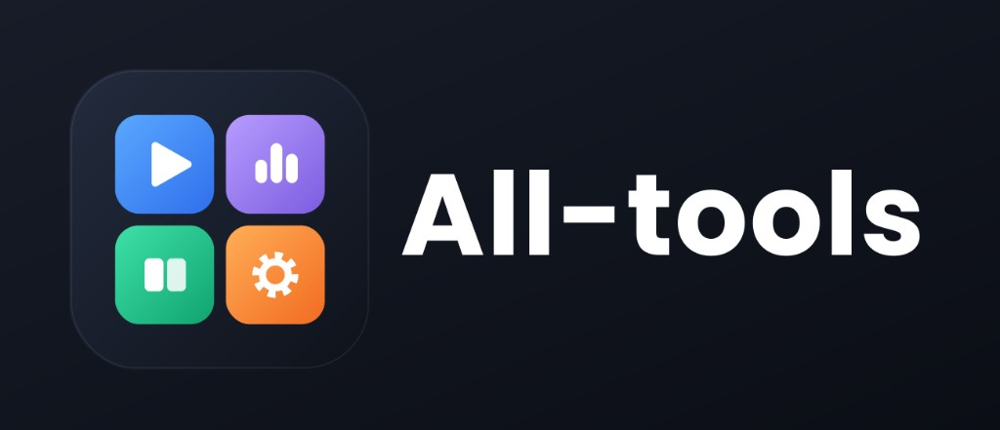

# All-Tools

로컬 전용 Electron 도구 모음(Movie2GIF 변환, 피치&볼륨 조절, 이북(eBook) 정리(영역 추출·PDF 중복 페이지 제거). 로그인·회원·웹 접속 없이 이 PC에서만 동작하며, **기능만 추가**하면 된다.

## 명령

| 명령 | 설명 |
| --- | --- |
| `npm install` | 최초 1회 |
| `npm run dev` | 실행 (화면 소스를 감시 빌드하고 저장 시 창을 자동 새로고침) |
| `npm run dev:restart` | 중지 후 재기동 |
| `npm run dev:stop` | 이 프로젝트의 Electron 프로세스를 모두 종료 |
| `npm run build:release` | Windows MSI + portable zip → `release/` |
| `npm run build:release:mac` | macOS dmg → `release/` (macOS 에서만 실행 가능) |

산출물 이름: `AllTools_<YYMMDD_HHMMSS>_<arch>.msi`, `AllTools_portable_<stamp>_<arch>.zip`, `AllTools_<stamp>_<arch>.dmg`.

서버·네트워크 포트가 없다. 화면과 기능 처리는 Electron 내부 통신(IPC)으로만 연결되므로 다른 PC·브라우저에서는 접근할 수 없다. 트레이 아이콘도 없고, 창을 닫으면 종료되며, 실행 중에 다시 실행해 여러 개를 동시에 띄울 수 있다.

## 구조

- `main.js`, `preload.cjs` — Electron 진입점 (API 호출과 파일/폴더 선택 등 네이티브 기능은 preload 로 노출, 메인에서 요청 출처 검증)
- `electron/devRenderer.js` — 개발 시 화면을 `.dev-dist/` 로 감시 빌드 (운영은 `dist/` 를 파일로 로드)
- `electron/api/coreApi.js` — 기본 API (앱 정보, 설정, 업데이트 확인)
- `electron/modules/*` — 기능별 API (변환, 이북)
- `electron/settingsService.js` — 설정 저장
- `shared/*` — 메인/화면 공용 코드 (`constants.js` 에 앱 이름·버전)
- `src/` — React 화면. `src/lib/apiClient.js` 가 API 클라이언트 (`window.frame.api` → IPC `api:call` → `dispatchApi`)

## 기능 추가 방법

1. 화면: `src/features/<id>/` 를 만들고 `src/features/registry.js` 에 한 줄 등록 (2개 이상이면 사이드바 표시)
2. 서버 API: `electron/modules/<name>.js` 에서 `defineApi(이름, 핸들러)` 로 등록하고 `electron/modules/index.js` 에 추가
3. 화면에서 호출: `api('이름', 본문)`
4. 파일은 업로드하지 않고 `window.frame.pickOpenFiles` 로 로컬 경로를 받아 처리하며, 결과는 로컬 폴더에 저장한다.
5. 환경설정 항목 추가: `src/components/settings/GeneralSettingsPanel.jsx` 에 섹션 추가

## 데이터 위치

- 개발: `<프로젝트>/data` (설정 `settings.json`)
- portable: exe 옆 `data` (zip 안에 `.portable` 표시 파일 포함)
- 설치형: 사용자 데이터 폴더 아래 `data`
- `APP_DATA_DIR` 환경변수로 재지정 가능

## 앱 이름·버전 바꾸기

`shared/constants.js` 와 `package.json`(name/version/build.appId), `installer/Product.wxs` 의 UpgradeCode 를 새 앱에 맞게 바꾼다.

## 아이콘

- 원본은 `assets-src/icon.svg`(벡터)이고, `build/icon-source.png`(1024)로 렌더해 둔 것에서 `npm run dev`/빌드 시 `scripts/prepare-icons.mjs`가 `build/icon.{png,ico}`, `public/icon.png`, `public/favicon.ico`를 만든다.
- 아이콘을 바꾸려면 `build/icon-source.png`를 교체한 뒤 `node scripts/prepare-icons.mjs`를 실행한다.
